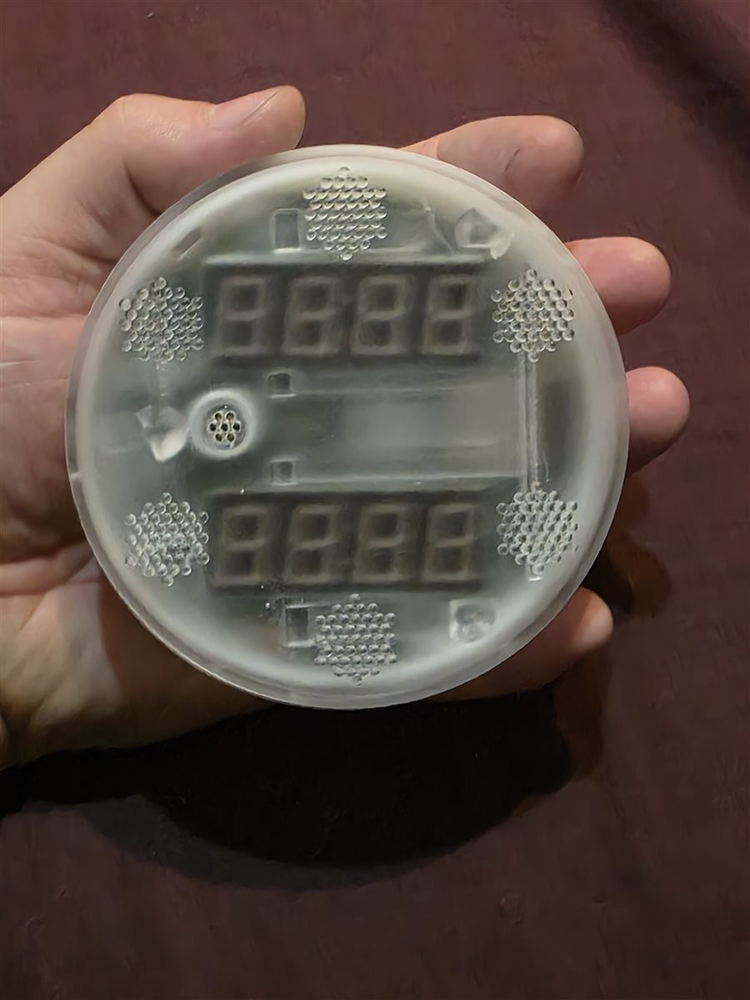
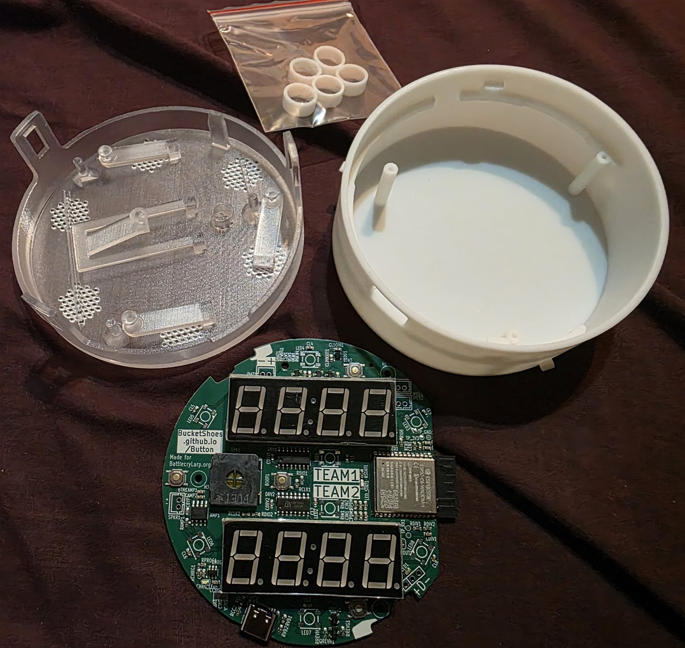
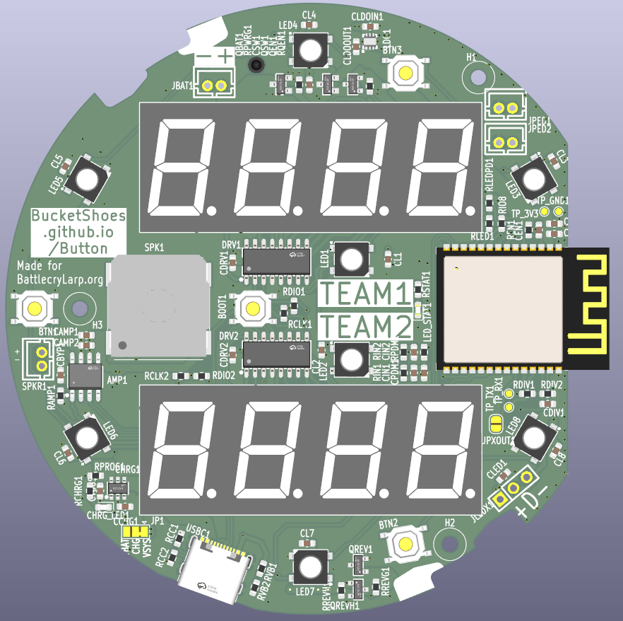
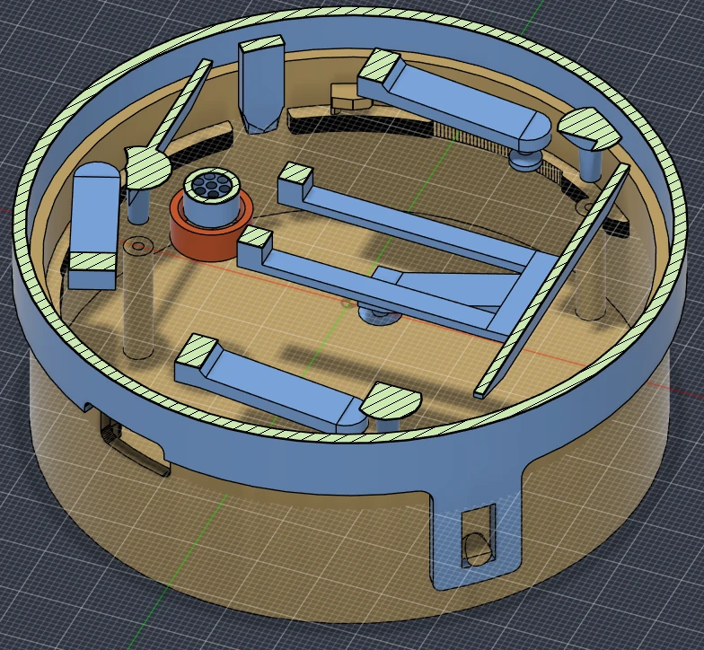

# Capture button

A capture point for LARP battle games, made for [Battlecry LARP](https://battlecrylarp.org). Two teams fight
over a hand-sized button. To take it you hold its lid down for a few seconds, which is long enough
for an enemy nearby to hit you first. The button shows who owns it with a ring of team-coloured
lights, and can run a clock for each team, like a reverse chess clock: whoever owns it longest wins.

We used to mark points with scrunchies or flags on a pole, or with a chess clock, which needed a ref
standing next to it holding up a flag so players could see the score from a distance. The button lights
up for itself, and a capture takes a deliberate hold rather than the instant slap of a chess clock.

<p align="center"><a href="https://bucketshoes.github.io/Button/"><b>Open the control page</b></a>
&nbsp;·&nbsp; <a href="https://bucketshoes.github.io/Button/?demo"><b>Try the demo</b></a> (no hardware needed)</p>

The control page runs in Chrome on a phone and talks to the buttons over Bluetooth. From it a ref can see every
button at once, pause and resume the whole game, adjust clocks and change settings. The buttons work
fine without it. **The demo** runs five simulated buttons in your browser, with clocks ticking and captures happening
by themselves. Every control works on them, so open a button's settings and try things out.

| | |
|---|---|
|  |  |
| Assembled, lid on (displays off) | Board, lid and shell as delivered by JLCPCB / JLC3DP |
|  |  |
| The b43 board (KiCad) | Case section: lid, return spring and pushers over the shell |

Photos of it powered on don't come out: the displays and charge LED blow out, so the photos above show it off.

## What's in it

- **ESP32-C6** module, two 4-digit 7-segment displays (one per team), 8 WS2812 LEDs in a ring,
  three switches under the lid, a speaker, USB-C charging and an 18650 cell.
- A **3D-printed case**: a translucent lid that presses the switches through printed pushers, over a shell
  that holds the board with a twist-lock. The shell is JLC3DP's 9600 white resin, thin enough that the
  LEDs glow out through its sides. The lid is 8001 clear resin: without any smoothing treatment it's a little
  diffuse, but the large displays read easily through it.
- **Firmware** in C on ESP-IDF, with a Bluetooth LE protocol for the control page.

## What's in this repo

| Where | What |
|---|---|
| [`src/`](src) | Firmware (ESP-IDF via PlatformIO): see [Building the firmware](#building-the-firmware) |
| [`docs/index.html`](docs/index.html) | The control page, served by GitHub Pages ([`demo.js`](docs/demo.js) is its demo mode; [`sw.js`](docs/sw.js) and the manifest make it installable and usable offline) |
| [`docs/ble-protocol.md`](docs/ble-protocol.md) | The Bluetooth protocol, if you want to write your own controller |
| [`docs/hardware.md`](docs/hardware.md) | Pin map, power, displays, LEDs and audio, as built on board b43 |
| [`docs/design-notes.md`](docs/design-notes.md), [`docs/plans.md`](docs/plans.md) | Design notes, game ideas, and what's planned |
| [`pcb/`](pcb) | KiCad 10 project for board b43, and the JLC production files |
| [`case/`](case) | Case STEP (lid, shell and sleeve, v43) as sent to JLC3DP |
| [`docs/next-revision.md`](docs/next-revision.md) | **Read this before building your own:** what we'd change after the first boards and cases arrived, and the cost |

## Building one

Everything was ordered from JLC: the board assembled by JLCPCB, and the case printed in resin by JLC3DP.

- **Every assembled part has an LCSC part number** in the board file (`LCSC Part #`), so the BOM and placement files
  in [`pcb/production b43.zip`](pcb) go straight into a JLCPCB assembly order. They're mostly basic and
  promotional parts, so the extended-part fees stay low.
- **Some soldering is still needed.** JLC wouldn't place the 8 WS2812B LEDs: they're moisture class MSL 5a,
  even though they're listed as available for economic assembly. The 18650 holder on the back and any external
  wires (speaker, pedals, LED strip) are also hand-soldered.
- **A pouch cell instead of the 18650** works fine, but connect it through a plug (JBAT1 takes a 2-pin PH 2.0
  connector) rather than soldering it straight on. The ESP is always powered from the cell, so a hard-wired cell
  leaves no way to power-cycle a stuck button.
- **Order the case** from [`case/larp-v43 print.step`](case): the shell (and sleeve) in 9600 white resin, the lid in 8001 clear resin, untreated.
- **Flash the firmware** over USB-C (see below), then connect from the control page.
- **Before ordering**, read [`docs/next-revision.md`](docs/next-revision.md): the first articles showed fit,
  spring and rattle problems in the case, and a few board changes.

### Opening the board in KiCad

[`pcb/`](pcb) has the schematic, board, project libraries (`LARP.kicad_sym`, `LARP.pretty`), design rules and
Fabrication Toolkit settings. It needs KiCad 10.

- **3D models:** the EasyEDA/LCSC models aren't in the repo, because their redistribution terms are unclear. Fetch them with:

  ```
  pip install easyeda2kicad
  python tools/fetch_3d_models.py
  ```

  The script puts each model where the board expects it, and checks it against [`pcb/models.sha256`](pcb/models.sha256), the exact files
  the board was designed with. The board file and gerbers don't depend on them; only the 3D view does.
- **Schematic:** it matches the b43 board, except that USBC1 uses a different 16-pin USB-C footprint on the board.
  The mounting holes and a net tie are on the board only.
- **How the files were made:** scripts generated the KiCad files with the parts and nets but no layout. The
  layout was then done by hand in KiCad, and later tweaks were a mix of KiCad edits and direct edits to the files,
  so the files here, not the scripts, are the source.

## Licence

- **Firmware, control page and tools:** [GPL-3.0-or-later](LICENSE).
- **Hardware (`pcb/`, `case/`) and documentation:** [CC BY-SA 4.0](LICENSE-hardware.md).

## Building the firmware

The firmware is C on **ESP-IDF 5.5.1**, built with [PlatformIO](https://platformio.org) (the pioarduino platform 55.03.31,
which brings its own ESP-IDF; nothing else to install).

1. Install VS Code and its PlatformIO extension, then open this folder. The first build downloads the toolchain,
   which takes a few minutes.
2. Plug the board in by USB-C and pick its port in the status bar.
3. Run the PlatformIO **Upload** task. The ESP32-C6's native USB usually just works, but not on every module. If it won't
   connect, or keeps dropping out, power it fully down first: take out the 18650, or unplug the pouch cell. Then hold
   BOOT (inside the case) while plugging in USB, and upload. That keeps the chip in its bootloader. On USB alone the
   power peaks at startup can reset the chip in a loop, and BOOT stops the loop long enough to flash.
4. Open the control page and connect. Settings (name, mode, durations, colours and so on) are set from the page and
   saved on the button, so there's nothing to configure in the code.

From a terminal: `pio run -t upload --upload-port <port>`, then `pio device monitor --port <port>` for the serial log
(a status line every second and an event log). On Windows `pio` usually isn't on PATH; it's
`~\.platformio\penv\Scripts\pio.exe`.

Chip options are in `sdkconfig.defaults`; delete the generated `sdkconfig.button` after editing it.
The flash layout is in `partitions.csv`: a 3 MB app and a 4 MB `audio` partition.

<details>
<summary>Optional: a music clip</summary>

The `audio` partition can hold a clip of about 40 s, played from the page with the "Music clip" sound. It was added as a
speaker test, and the button works fine without it. Upload leaves it alone unless `custom_audio` in `platformio.ini` says otherwise:
`upload` also writes `audio/test_audio.bin`, and `erase` blanks it. Set it back to `keep` afterwards, because the clip makes uploads slow.

To make the clip from any MP3 (`transcode.ps1` uses Windows' own decoder, so no ffmpeg is needed):

```
powershell -File tools	ranscode.ps1 -Src "song.mp3" -OutDir <dir> -OutName music.wav
python tools\make_test_audio.py <dir>\music.wav audio	est_audio.bin
```

`make_test_audio.py` takes the first 40 s and normalises the level (see `--help` for the start point, high-pass and
compression). It also writes `audio/test_audio.wav`, the exact samples the button plays, for listening on a PC.
The format is raw 16-bit mono PCM at 48 kHz with a 16-byte header.
</details>

## Control page (Web Bluetooth)

[docs/index.html](docs/index.html) is published by GitHub Pages at
<https://bucketshoes.github.io/Button/>. Open it in Chrome (Android, or Chrome/Edge on a computer) and
press **Connect a button**. You can connect several buttons. With no hardware, add `?demo` to the address for five simulated buttons
(<https://bucketshoes.github.io/Button/?demo>).

- **Install it as an app** (optional): use the **Install as an app** link at the bottom of the page, or Chrome's menu
  (**Add to Home screen** on Android, **Install** on a computer). The page doesn't pop up an install offer by itself.
  It then opens full-screen from its own icon. Installed or not, it also works with no internet once it has been opened
  once, which helps at game sites with no reception. With a connection it always loads the newest version.
- **iPhone:** no iPhone browser has Web Bluetooth (they're all Safari underneath, including Chrome), so the page
  can't connect, installed or not. A Web Bluetooth browser app such as Bluefy may work; it hasn't been tested.

- **Keep screen on** (at the bottom of the page, on by default): stops the phone locking while the page is in front, so a ref can glance at it mid-game. Chrome allows it straight away; a browser that wants a tap first gets one from the next tap anywhere on the page. Next to it, "(on)" means it is working. Untick it to save battery; the choice is remembered.
- **Game bar** (top): pause and resume the whole game, and play a sound (whistle by default) on every button. Game resume undoes the game pause: each button goes back to exactly what it was doing, so a button that was paused or uncaptured stays that way.
- **Overview:** one row per button, sized so about 5 fit on a phone screen. Name and battery on the left, then a box per team (team names once at the top of each column):
  - thick border in the team colour, filled for the owner;
  - underlined time while that clock is ticking, blinking on a win. In one-timer mode the shared clock shows in the owner's box only, and the other box is empty;
  - a small pie fills while someone holds the lid, in the box of the team about to capture;
  - tap a row to jump to that button's panel.
- **Each button** gets its own panel below:

- **Controls:** start, pause, reset, identify (displays and ring flash with beeps for 3 s), battery, and power off.
- **Owner:** set the owner (uncaptured / team 1 / team 2).
- **Reboot** (in settings), for when something is stuck. Settings are kept; the game state is lost.
- **Sounds:** play any of the button's sounds, or stop them.
- **Clocks:** live clocks (one shared clock in one-timer mode), −1 min / −10 s, +1 min / +10 s, or set an exact time (m:ss), even while running.
- **Settings (saved on the button):**
  - name and mode (teams only / one timer / two timers);
  - count down or up, and whether the numbers show on the displays;
  - durations (one in one-timer mode), the owner after reset, the first capture (random / team 1 / team 2), the hold time, the team colours, the volume and the LED brightness;
  - "Copy to all" sends the settings to every connected button, keeping each name.
- **More for all buttons** (under the overview): identify, power on and power off all of them at once.
- **Reboots:** the panel shows how many times the button restarted since power-on, why it last did (for example brown-out) and how long ago. Wakes from deep sleep (shipping, low battery) don't count. The count is kept in RTC RAM: a reset, a reflash or a brown-out keeps it; only losing all power (the cell and USB both gone) clears it.
- **Wall clock** with seconds in the top corner.

The protocol is in [docs/ble-protocol.md](docs/ble-protocol.md).

## Behaviour

- **Modes:**
  - **Teams only:** the ring shows who owns the button. There are no clocks: the owner's display shows dashes ("--:--") with the same colon, highlight and hold cues as a clock, and the other display is blank.
  - **One timer:** one shared clock, which runs whichever team owns the button. Whoever owns it when the clock runs out wins. It shows only on the owner's display, and the other display is blank, so it reads as one clock that belongs to them. While uncaptured it shows on both, neither lit.
  - **Two timers:** a reverse chess clock; the owner's clock runs.
  - **"Own" and "hold":** a team *owns* the button (it's in their control); a player *holds* the lid (pressing it).
- **Clocks:** count down (win at 0:00) or up (win at the duration; a duration of 0 means no limit). Default: two timers counting down from 10:00.
- **Face press:** any of the three switches counts (an OR). The lid counts as pressed until 50 ms after the last contact.
- **Hold**, where H is the hold time (default 3 s):
  - **Up to H:** the ring shows the team about to capture. The first LED is lit at once, and the others wait dim, at the lowest brightness setting. Each comes on in turn with a short smooth fade (0.2 s) at the end of its fifth of the hold, so it's a clear step around the ring, and the capture happens as the 6th comes on. While it builds, the lit LEDs are at least 16 % (8 times the dim ones, so they're clearly apart at any setting) and the team LEDs light as bright as the ring; it goes back to the set brightness once captured. The build-up sound is made for the hold time, so it lasts exactly until the capture: a rising whoop (sci-fi), or drums accelerating under a climbing horn, ending in a snare roll (medieval). Letting go early puts it back as it was.
  - **At H, capture:** while running it goes to the other team; while paused it resumes with the same team.
  - **Uncaptured:** the team is decided the moment the hold starts and shows straight away: the ring fills in its colour and its display lights. Wrong colour? Let go and press again: every press that doesn't capture flips the team for the next press. The first press uses the "first capture" setting, which is random by default.
  - **H to H+4 s:** a ding each second, then a **pause** at H+4 s (7 s with the default hold). The clocks go back to where they were before the hold, and the paused owner is:
    - **was running:** whoever had it before the hold;
    - **was uncaptured:** the team just picked, so a 6 s hold pre-sets the owner at 10:00 (for example at a respawn);
    - **was paused:** the other team, so each further 6 s hold swaps it.
  - **H+4 to H+9 s:** doom each second, then a **reset** at H+9 s (12 s).
  - **H+9 to H+14 s:** after a second, the displays say "HoLd" "oFF" with a falling tone and the ring drains; at H+14 s (17 s) it **powers off**. Let go before that and it stays on, just reset.
  - **During a game pause** (from the page): a press plays the pause sound and nothing is captured, so a player who hasn't noticed can't change anything. The ring fills slowly white; at H+4 s the button leaves the game pause into a regular pause, owner and clocks unchanged, and works normally from then on (so the page is never required). H+9 s still resets.
  - **After a win**, the fanfare repeats for 20 s. Holding dings every second all the way to the reset (there is no pause to warn about): H silences the fanfare, and H+9 s resets.
- **Idle cues:**
  - **Not held, the button shows only the true state.** A hold let go early snaps straight back, so nobody runs off thinking they captured it.
  - **Uncaptured:** a faint white pulse on the ring (0–10 %, 0.5 Hz), no team colour, and neither display highlighted. The team the next press goes for has one colon dot missing: subtle, for admins.
  - **Paused with an owner:** the ring blinks faintly in their colour, and their display shows a single slow-blinking dot instead of the colon.
- **After reset:** uncaptured, or owned by the team set in "after reset". In teams-only mode that team is simply live. With clocks it waits, paused, for Start or a hold.
- **Triple tap:** battery ("bAtt" plus a percent for 6 s, with a green gauge on the ring). It works in every mode and with the numbers hidden.
- **Power:** see "Power" below.
- **BOOT:**
  - Hold: the displays say "HoLd" "oFF" with a falling tone, and at 3 s it **powers off** (no need to let go).
  - Keep holding to 8 s: restore the default settings (it wakes briefly to play the sound).
  - A press while the music clip plays only stops the clip.
- **Volume and LEDs** default to 50 %. Full volume browns out on USB-only power. The brightness setting dims the displays too.
- **Brown-out recovery:**
  - The game carries on. The game state is copied to RTC RAM all the time, and a brown-out reset leaves that RAM and the low-power timer running. After a brown-out, crash or watchdog reset, the button comes back with the same owner, clocks and running/paused state, with the clock advanced by the second or so it spent rebooting. A button that was off comes back off. If the RAM didn't survive (the checksum fails), or the power was really lost, it starts fresh as after a reset. A reboot from the page also starts fresh.
  - Volume and brightness start capped at 50 % (not saved), so the startup sound can't cause another brown-out.
- **Display brightness:** 1/8 is the GN1650's lowest step. At low settings the highlighted display stays one step above the dim one, so you can still tell them apart.
- **Displays:** the running owner's display is bright, with its colon flashing at 4 Hz. The others are dim (two timers) or blank (one timer, teams only).
- **Countdown:** at 60, 30, 20 and 10..1 s from a win: blips (sci-fi), or a horn at a minute and then bells (medieval). Skipped when the numbers are hidden.
- **Sound sets** (setting "Sounds"): medieval (the default) or sci-fi. They change what players hear: the capture build-up, the capture calls (a trumpet for team 1, a horn for team 2), the countdown and the win fanfare. Pause, reset, power and the other admin sounds stay plain synth beeps in both, so they read as not part of the game. The medieval set is synthesised (FM bells, brass, drums), not recordings. In it the switches make no sound of their own (the three are one lid to players), the build-up grows from silence in its first second, so a tap already says "keep holding", and letting go early gets a sagging horn. `tools/render_sounds.c` renders both sets to WAV files in audio/preview with the firmware's own synth.c and sounds.c, to listen on a PC (the build line is at the top of the file; it needs a host gcc, e.g. WinLibs MinGW-w64).
- **LEDs:**
  - LED1 and LED2 show the team colours at medium brightness.
  - The ring shows the owner.
  - Each switch lights its two nearest ring LEDs white.
  - The external strip (16 assumed) mirrors the ring.
- **Music clip** (optional, see "Building the firmware"): plays only when started from the page. A face press or BOOT stops it.
- **Serial:** a status line every second plus an event log.

Not used yet: the pedals (only logged), storage-charge management on USB, coded PHY or a mesh between buttons, and the event log/timeline. See [docs/plans.md](docs/plans.md).

## Power

- **On:**
  - Everything is powered.
  - Between loop passes (20 ms when idle), the CPU light-sleeps.
  - The amp and PDM output stop 1 s after the last sound, because a running PDM keeps the chip awake. The PDM and amp then start together, which may give a small click. The first sound of an interaction is queued behind exactly 50 ms of silence (`AMP_WAKE_MS` in `src/audio.c`) that plays while the amp starts, so it's a fixed 50 ms late but never cut short. Sounds that start while already awake wait behind up to 30 ms of DMA buffering. Quick follow-ups (taps, holds) aren't delayed. In the last 61 s of a countdown the speaker stays awake.
  - **Idle** means no press and no page command. The times are settings (Advanced, in minutes, 0 = never):
    - After 11 min, every second ring and strip LED goes off (LED1 and LED2 stay).
    - After 31 min, brightness drops to 10 % (or stays lower if it's already set lower).
    - After 61 min, **auto-off** (below).
- **Auto-off:**
  - Dark (PWR_EN low), but still in the game and the network: the clocks keep running, and it relays and can be reached exactly as when on.
  - A tap, or any command from the page or the network, brings it straight back as if it had stayed on. The tap isn't a game press, and there's no startup test.
  - The ring, strip and displays show the state for 1.5 s every 20 s (at the set brightness, all the LEDs, both displays), for anyone too far away to tap it. After a win the ring blinks on-off-on-off-on in it, so it reads as already won. The battery is read then too.
  - A countdown running on it brings it back for its last 5 min (at 5:05), and a win brings it back too.
  - After 121 min idle it turns off, unless a countdown is running on it.
- **Turning it off:**
  - Hold the lid for 17 s (hold + 14 s), hold BOOT for 3 s, use the page's Power off (the page then lets go of its link to that button), or let auto-off run out.
  - Clocks pause; a teams-only owner stays. The game is saved to flash as well.
- **The power choice:** on, off or shipping, whichever was last chosen, is saved in flash.
  - Any reset (USB, a crash, the cell swapped) comes back to it. A new firmware image comes up on, so a flash shows the startup test.
  - Only a press, a hold or a page command changes it. Nothing else turns the button on or takes it out of shipping. Auto-off and a dead battery don't change it.
- **The game state:** kept in RTC RAM, which survives deep sleep and every reset but a power-on, with the LP timer for the time away (a clock that ran out meanwhile wins). Every shutdown also writes it to flash. After a power-on (the cell swapped) it comes back from flash with the clocks paused. A reboot from the page starts fresh.
- **Off:**
  - PWR_EN is low, so only the ESP is powered, and it light-sleeps.
  - BLE keeps advertising slowly (legacy only, every 2–2.5 s), so the page can connect and power it on, or identify it.
  - It checks the battery hourly, briefly powering VSYS to read it.
  - BLE only runs for 8 days; then it goes to deep sleep, as in shipping (a press peeks).
- **Shipping** (the page's Shipping button):
  - Deep sleep with BLE off and everything unpowered, on battery or USB.
  - A lid press wakes it, and so does USB appearing or going (BOOT can't: IO9 isn't an LP pin).
  - A press or USB appearing peeks; USB going just sleeps again. After the peek it goes back to shipping, unless the peek turned it on.
- **Peek:**
  - A lid press while off or shipping shows the battery for about 6 s.
  - It turns on only on a clear intent, so a bump doesn't wake it: two more presses during the peek, or a press started during the peek and held for 1.5 s (the ring fills white). The press that woke it doesn't count.
  - Otherwise it goes back to off, or shipping.
- **Battery levels** (not on USB). The battery figure is an estimate close to the unloaded voltage: the highest recent reading, falling at most 3 mV a minute under load, so LED and speaker droop doesn't count. A one-minute average of the loaded reading below 3.0 V also counts as dead.
  - **Low, below 3.5 V:** on works as usual, with the battery shown for 0.9 s (and a beep) every 30 s, and auto-off after 11 min idle at most. Off has no BLE (deep sleep, a press peeks and can still turn it on; it checks the cell every 6 h).
  - **Dead, below 3.3 V (0 %):** no radio, speaker or LEDs. On or auto-off goes dark at once ("bAtt Lo" for 3 s at the lowest brightness) into deep sleep. The game is kept, clocks running on the LP timer. It checks the cell hourly. A press shows "bAtt Lo" again; it won't turn on. USB brings it back in auto-off (or off, if it was off).
  - **Overdischarge, below 3.1 V:** the cell is unprotected, so this is the cut-out. Deep sleep with only USB appearing as a wake source: no timer, no lid, the clocks stop.
- **On USB:** USB power (the VBUS rail, read digitally) and USB data (a computer that has enumerated it) are separate. See design/power-lifecycle.md.
  - USB power is all the battery and sleep decisions use. The battery levels don't apply while it's there, and in deep sleep only the VBUS rail appearing or going wakes it. A power bank turning itself on and off just peeks (from shipping) or does nothing.
  - USB data only matters while it's awake. While on, it stays awake 10 s after a boot, after turning on and after USB power appears, and 5 min after a BOOT press, so a computer can connect. A computer that is connected keeps it awake through ESP-IDF, but doesn't turn it on.
- **Not measured yet:** the actual currents. BLE sleep uses the main crystal as its low-power clock (Espressif's RC-clock option supports legacy adverts and scanning only, not connections). A 32 kHz crystal on IO0/IO1 would allow lower sleep current.
- **Volume:** the slider is in dB (-40 dB to full), so each step sounds about the same.

